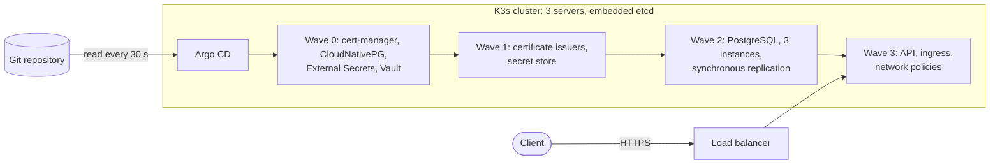

# k3s-gitops-reference

A three-node K3s cluster that is built entirely from this repository, and can be destroyed and rebuilt from it with one command.

It runs on a laptop in Docker. It is a reference for how I set up a small, highly available platform: Git as the only way in, PostgreSQL that does not lose acknowledged writes, secrets kept out of Git, TLS issued automatically, and network access closed by default.

Everything here was written for this repository. It contains no code, configuration or data from any client.

## Try it

You need Docker, `kubectl` and `helm`, on a machine that can give Docker at least 8 GB of memory and 4 CPUs. Three control planes on one host are demanding: on less than that, nodes miss their deadlines and restart.

```bash
make tools     # installs the pinned k3d into ./bin, after verifying its checksum
make up        # creates the cluster and lets Argo CD deploy everything
make test      # checks the running cluster against the claims below
make drill     # stops the node that hosts the database primary, while a client is writing
make rebuild   # destroys everything, rebuilds from Git, verifies, prints the total time
make destroy
```

Nothing outside this directory is modified: the cluster uses its own kubeconfig in `.cache/`, and `~/.kube/config` is left alone.

## Measured

Every push runs the full cycle on a fresh GitHub-hosted runner (4 vCPU, 16 GB): build from Git, verify, break, verify again. Figures from the run on 2026-11-15:

| Measure | Result |
|---|---|
| Empty machine to verified platform | 5 min 11 s, including image downloads |
| Writes acknowledged during the failure drill | 199 |
| Acknowledged writes missing from the database afterwards | **0** |
| Requests that failed while the primary moved to another node | 47 |
| Time for the stopped node to rejoin and PostgreSQL to return to 3 instances | 35 s |

The latest figures are in the summary of each run under **Actions**.

## What it demonstrates, and how each claim is checked

| Claim | How it is built | Checked by |
|---|---|---|
| Highly available control plane | 3 K3s servers with embedded etcd; the cluster keeps quorum with one node down | `make test`, `make drill` |
| Git is the only way in | Argo CD deploys every component from `gitops/`; manual changes are reverted | `make test` (every application Synced and Healthy) |
| No acknowledged write is lost (RPO = 0) | PostgreSQL with 3 instances and synchronous replication, one instance per node (CloudNativePG) | `make drill` compares what the client was told with what the database holds |
| Secrets stay out of Git | Vault holds the value; External Secrets copies it into the cluster using Kubernetes auth | `make test` searches the repository for the live password |
| TLS without handling keys | cert-manager issues the ingress certificate from a CA it created | `make test` verifies the chain against that CA |
| Network closed by default | Default-deny ingress in the application namespace, with each allowed flow listed | `make test` tries to reach the database and the API from another namespace |
| Rebuildable from Git | One command from an empty machine to a verified platform | `make rebuild`, and CI on every push |

## How it fits together



Argo CD is the only component installed by a script. From there it reads `gitops/apps`, an app of apps with one Application per component, and deploys them in four waves: each wave waits for the previous one to be healthy.

### Running an unpushed change

By default `make up` does not read GitHub. It publishes the working tree to a small Git server next to the cluster, and Argo CD reads that. What runs is exactly what is on disk, and the GitOps loop works offline:

```bash
# edit something under gitops/, for example the number of API replicas
make sync      # publish it; Argo CD applies it within 30 seconds
make status
```

`SOURCE=github make up` reads the public repository instead. That is the mode CI uses, so it is the one verified on every push; the local mirror mode is not exercised by CI.

## The failure drill

`make drill` starts a client that writes through the API every 200 ms and records each write the API acknowledges. It then stops the node that hosts the PostgreSQL primary, keeps writing for a minute, and compares the two lists.

It fails if a single acknowledged write is missing from the database, or if the primary did not move. It also reports how long writes were unavailable during the failover, and how long the stopped node takes to rejoin.

The latest report is written to `.cache/drill-report.md`, and CI publishes it in the summary of each run.

## Layout

```
bootstrap/          the only imperative part: K3s server settings and Argo CD's own settings
gitops/apps/        app of apps: one Argo CD Application per component, pinned versions
gitops/platform/    certificate issuers, secret store
gitops/data/        PostgreSQL cluster and its credentials reference
gitops/workloads/   the demo API, its ingress and network policies
scripts/            one readable script per Makefile target
docs/adr/           the decisions, and what they cost
```

Versions are pinned in two files: tools in `versions.env`, charts in `gitops/apps/values.yaml`.

## Decisions

- [0001: Three K3s servers with embedded etcd](docs/adr/0001-three-k3s-servers.md)
- [0002: Argo CD, app of apps, ordered by sync wave](docs/adr/0002-gitops-app-of-apps.md)
- [0003: Synchronous replication, strictly enforced](docs/adr/0003-synchronous-replication.md)
- [0004: Secrets outside Git](docs/adr/0004-secrets-outside-git.md)

## Limits

This is a reference that runs on one machine. It is honest about what that changes:

- **One host.** The three nodes are containers on the same machine. Stopping one exercises quorum, failover and rescheduling, but not a real network partition or the loss of a disk.
- **Vault runs in dev mode**: in memory, already unsealed, with a fixed root token. It is there so the path a secret takes is the real one. A real Vault needs storage, unsealing and its own high availability.
- **The certificate authority is private.** Certificates are valid only for clients that trust this cluster's CA. Production would use ACME or an organisation's PKI through the same `ClusterIssuer` mechanism.
- **Storage is node-local.** Each PostgreSQL instance writes to its own node's disk, and replication happens in PostgreSQL. There is no distributed storage layer here.
- **Network policies cover ingress only.** Egress from the application namespace is open.
- **No monitoring stack.** Prometheus, Grafana and Loki are left out to keep the memory footprint within a laptop's reach.
- **The demo API is open.** PostgREST accepts anonymous reads and writes on one table, which is what the drill needs and nothing a real service should do.
